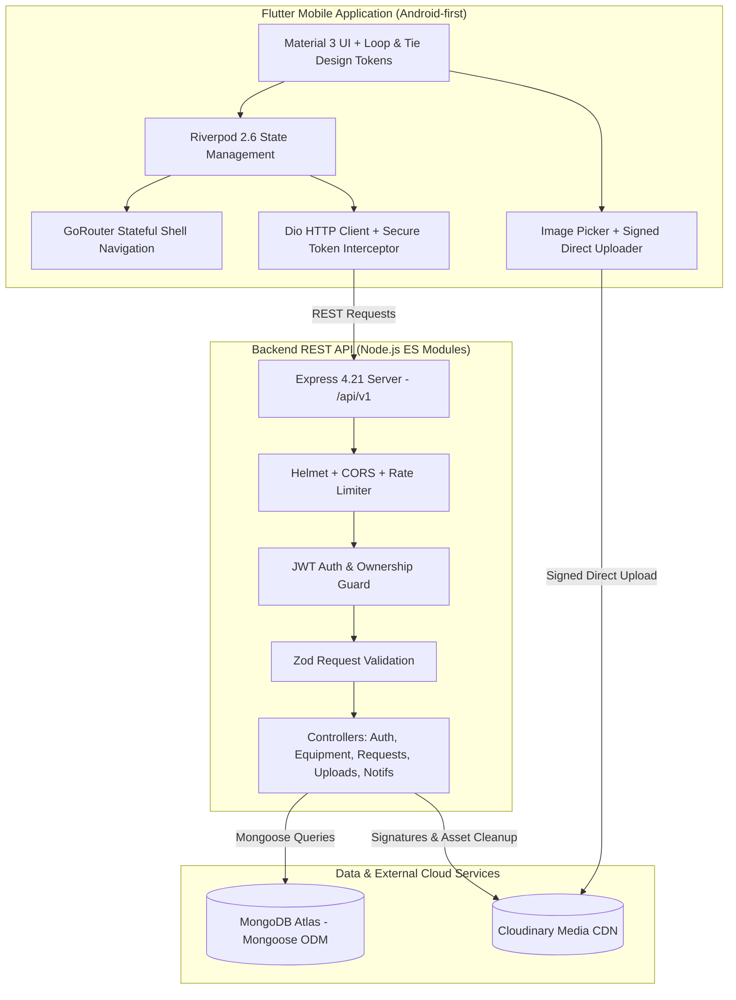

# LabLend — Laboratory Equipment Marketplace

> **"Better access to science."**

LabLend is a complete, production-oriented scientific equipment marketplace application for colleges, universities, research institutions, and laboratories. It democratizes access to specialized scientific instruments (fluorescence microscopes, ultracentrifuges, high-frequency oscilloscopes, UV-Vis spectrophotometers, analytical balances, and incubators) through verified institutional sharing, transparent scheduling, and collaborative request workflows.

The visual direction and user experience draw direct inspiration from [Loop & Tie](https://www.loopandtie.com/) — translating its warm, editorial typography, generous negative space, curated image storytelling, and purposeful micro-interactions into a credible scientific marketplace.

---

## 1. System Architecture



---

## 2. Directory Structure

```text
LabLend/
├── flutter_app/                     # Android-first Flutter mobile application (Dart)
│   ├── assets/
│   │   ├── images/                  # Category graphics and fallback assets
│   │   └── icons/                   # Custom UI iconography
│   ├── lib/
│   │   ├── main.dart                # App entry point with ProviderScope
│   │   ├── app.dart                 # MaterialApp.router configuration
│   │   ├── core/
│   │   │   ├── config/              # ApiConfig with emulator (10.0.2.2) and LAN support
│   │   │   ├── constants/           # AppConstants, categories, conditions, storage keys
│   │   │   ├── errors/              # AppFailure, NetworkFailure, ValidationFailure
│   │   │   ├── routing/             # GoRouter with StatefulShellRoute bottom nav
│   │   │   ├── theme/               # Loop & Tie color system, typography, motion tokens
│   │   │   └── utils/               # Currency, date range formatters, input validators
│   │   ├── models/                  # UserModel, InstitutionModel, EquipmentModel, RequestModel
│   │   ├── services/                # ApiClient, AuthService, EquipmentService, UploadService
│   │   ├── providers/               # Riverpod StateNotifiers (Auth, Equipment, Requests, Notifs)
│   │   ├── widgets/                 # Reusable EquipmentCard, AppButton, StatusBadge, Shimmer
│   │   └── features/
│   │       ├── splash/              # Branded logo reveal with auto-routing
│   │       ├── onboarding/          # Editorial storytelling carousel
│   │       ├── auth/                # Login (with 1-tap demo logins), Register, Forgot Password
│   │       ├── navigation/          # MainScaffold with 4-tab persistent navigation
│   │       ├── home/                # Editorial hero, categories, recently listed apparatus
│   │       ├── discovery/           # Keyword search, domain chips, filter bottom sheet
│   │       ├── equipment/           # Multi-photo gallery, specs table, booking request sheet
│   │       ├── listings/            # My Listings, Create/Edit listing with image upload
│   │       ├── requests/            # Sent & Received tabs, interactive decision dialogs
│   │       ├── notifications/       # In-app notifications with unread badge counter
│   │       ├── profile/             # Institution verification badge, user profile
│   │       └── settings/            # Dynamic backend IP selector and emulator switch
│   └── test/                        # Flutter widget, theme, validation, and model tests
│
├── backend/                         # Node.js + Express REST API (JavaScript ES Modules)
│   ├── src/
│   │   ├── server.js                # Server bootstrap with graceful shutdown
│   │   ├── app.js                   # Express app with Helmet, CORS, Morgan, Error Handler
│   │   ├── config/                  # MongoDB database connection, Cloudinary SDK
│   │   ├── models/                  # User, Institution, Equipment, Request, Notification
│   │   ├── controllers/             # Auth, Equipment, Request, Upload, Notification
│   │   ├── routes/                  # REST route definitions under /api/v1/
│   │   ├── services/                # Request overlap validation, Notification dispatch
│   │   ├── middleware/              # JWT auth, Zod validation, rate limiter, error handler
│   │   ├── validators/              # Zod schemas for all request payloads
│   │   └── seeds/                   # Realistic scientific core facility seed data
│   ├── tests/                       # Vitest + Supertest API integration suite
│   ├── .env.example                 # Environment variable template
│   └── package.json                 # Backend dependencies and scripts
│
├── docs/
│   ├── api.md                       # Comprehensive REST API endpoint documentation
│   ├── database-schema.md           # MongoDB schemas, relationships, and indexes
│   └── setup.md                     # Step-by-step setup and emulator networking guide
├── .gitignore
└── README.md
```

---

## 3. Visual Design Direction (Loop & Tie Aesthetic)

The user experience reflects the editorial refinement of [Loop & Tie](https://www.loopandtie.com/):

| Design Element | Specification | Loop & Tie Homage |
| :--- | :--- | :--- |
| **Color System** | Primary Ink (`#20251F`), Secondary (`#686D65`), Warm Off-White (`#F7F7F2`), Pure White (`#FFFFFF`), Soft Sage (`#DCE8D7`), Muted Green Accent (`#66866A`), Pale Sand (`#EEE8DB`), Deep Forest (`#27382B`) | Natural, organic earth tones replacing sterile hospital blues |
| **Typography** | Editorial Serif (**Newsreader**) for display titles, modern sans-serif (**Plus Jakarta Sans**) for metadata, specs, and prices | Literary elegance combined with technical precision |
| **Surfaces & Cards** | 16px rounded corners, subtle `#E5E6DF` 1px borders, generous whitespace, zero harsh drop shadows | Tactile paper-like surfaces and card-based storytelling |
| **Motion System** | Micro (150ms), Card transition (280ms), Screen transition (350ms), easeOutCubic curves | Fluid, intentional reveals without distracting continuous loops |
| **Imagery** | Realistic high-resolution scientific instruments with neutral backgrounds and uniform aspect ratios | Curated photographic presentation |

---

## 4. Key Functional Workflows

1. **Editorial Equipment Catalog**:
   - Filter instruments by 9 scientific domains (Microscopy, Spectroscopy, Centrifugation, Chromatography, Thermal Analysis, Electronics, Cell Culture, Analytical Chem, General Lab).
   - Filter by transaction type (**Rent**, **Buy**, or **Both**), condition, and price limits.
   - Real-time search by title, description, and institution location.

2. **Rental & Purchase Booking System**:
   - Date range selector with automatic reservation duration calculation.
   - **Concurrency Conflict Protection**: Backend prevents double-booking and validates overlapping approved reservations.
   - Intended research description and orientation message to lab directors.

3. **Multi-State Request Machine**:
   - `pending` -> `approved` / `rejected` -> `completed` / `cancelled`.
   - Listing owners approve with orientation notes or decline with required reason.
   - Real-time in-app notifications generated for all state changes.

4. **Cloudinary Signed Media Upload**:
   - Mobile requests temporary cryptographic upload signatures from the authenticated backend.
   - Mobile uploads photos directly to Cloudinary without exposing API secrets.
   - Backend validates image ownership before allowing deletion.

5. **1-Tap Evaluator Demo Accounts**:
   - The login screen includes pre-configured demo chips for instant testing:
     - **Dr. Elena Rostova** (`erostova@stanford.edu` / `Password123!`) — Stanford Bioengineering Core
     - **Prof. Marcus Chen** (`mchen@mit.edu` / `Password123!`) — MIT Materials Systems
     - **Julian Vance** (`jvance@salk.edu` / `Password123!`) — Salk Institute

---

## 5. Quick Start Instructions

### Step 1: Start Backend Service
```bash
cd backend
cp .env.example .env
npm install
npm run seed       # Populates realistic scientific seed data
npm run dev        # Starts REST API on http://localhost:5000
```

### Step 2: Run Flutter Mobile App
```bash
cd flutter_app
flutter pub get
flutter run        # Connects to http://10.0.2.2:5000/api/v1 on Android Emulator
```

> **Android Emulator Networking**: The Android Emulator automatically routes `10.0.2.2` to your computer's `localhost`. If testing on a physical device, open **Profile -> Network Settings** in the app and set your computer's local Wi-Fi IP address (e.g., `http://192.168.1.150:5000/api/v1`).

---

## 6. Verification & Test Execution

### Backend Integration Tests
```bash
cd backend
npm test
```
**Results**:
```
✓ tests/api.test.js (5 tests passed)
  ✓ GET /api/v1/health (200 OK)
  ✓ Validation & Auth Protection (400 on invalid registration)
  ✓ Route protection (401 on unauthenticated access to /api/v1/auth/me)
  ✓ 404 Route Not Found handling
```

### Flutter Static Analysis & Unit Tests
```bash
cd flutter_app
flutter analyze
flutter test
```
**Results**:
```
Analyzing flutter_app...
No issues found! (ran in 14.9s)

00:03 +15: All tests passed!
✓ Models Serialization Tests (InstitutionModel, UserModel, EquipmentModel, RequestModel)
✓ Theme & Design System Tests (AppColors, Luminance Contrast, Formatters)
✓ Validators Unit Tests (Required, Email, Password length, Positive Number, Min Length)
✓ Widget Tests (AppButton, StatusBadge, EmptyStateView)
```

---

## 7. Documentation Index

- [REST API Reference](file:///docs/api.md): Complete route index, query parameters, and JSON payloads.
- [Database Schema](file:///docs/database-schema.md): Mongoose schemas, relationships, and indexes.
- [Setup & Deployment Guide](file:///docs/setup.md): Environment variables, Cloudinary keys, and networking tips.
