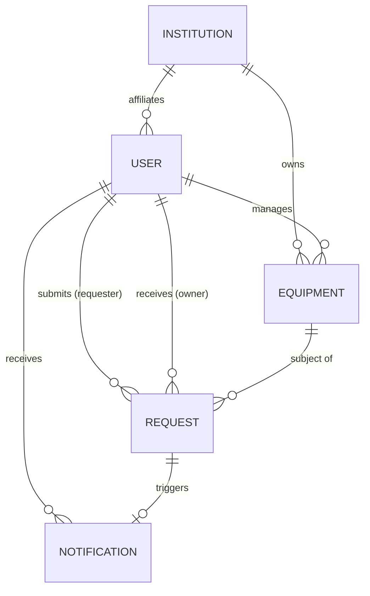

# LabLend MongoDB Database Schema Architecture

LabLend utilizes MongoDB Atlas via Mongoose ODM for persistent storage, with strict schema validation, timestamp auditing, normalized indexes, and referential integrity.

---

## 1. Schema Relationship Diagram

---

## 2. Collections Specification

### A. `users` Collection
Stores authenticated scientific researchers, laboratory managers, faculty, and administrative staff.

| Field Name | Type | Constraints | Description |
| :--- | :--- | :--- | :--- |
| `_id` | ObjectId | Primary Key | Auto-generated identifier |
| `fullName` | String | Required, Trim, Max 100 | Researcher full name |
| `email` | String | Required, Unique, Lowercase | Institutional email domain |
| `passwordHash` | String | Required, Hidden in JSON | Salted bcrypt hash |
| `contactNumber` | String | Optional, Trim | Direct telephone line |
| `department` | String | Optional, Trim | Department or institute division |
| `title` | String | Default: 'Researcher' | Academic or organizational rank |
| `institution` | ObjectId | Ref: 'Institution', Required | Affiliated laboratory or university |
| `role` | String | Enum: `researcher`, `lab_admin`, `faculty`, `student` | Account privilege tier |
| `accountStatus` | String | Enum: `active`, `pending`, `suspended` | Current operational state |
| `avatarUrl` | String | Optional | Profile photo URL |
| `lastLogin` | Date | Nullable | Timestamp of recent authentication |
| `createdAt` | Date | Auto | Creation timestamp |
| `updatedAt` | Date | Auto | Modification timestamp |

**Indexes**:
- `{ email: 1 }` (Unique)
- `{ institution: 1 }`

---

### B. `institutions` Collection
Represents verified universities, medical centers, academic departments, or commercial laboratory facilities.

| Field Name | Type | Constraints | Description |
| :--- | :--- | :--- | :--- |
| `_id` | ObjectId | Primary Key | Identifier |
| `name` | String | Required, Trim, Max 150 | Legal/institutional name |
| `type` | String | Enum: `university`, `college`, `research_institute`, `hospital`, `commercial_lab`, `other` | Institution category |
| `description` | String | Trim, Max 1000 | Core facility capabilities & mission |
| `address` | String | Optional | Physical street address |
| `city` | String | Required, Trim | Facility city |
| `state` | String | Required, Trim | State or province |
| `postalCode` | String | Optional | Postal code |
| `country` | String | Default: 'United States' | Operating jurisdiction |
| `contactEmail` | String | Regex email match | Official contact point |
| `contactNumber` | String | Optional | Primary laboratory switchboard |
| `verificationStatus` | String | Enum: `verified`, `pending`, `unverified` | Trust audit status |
| `verificationMetadata` | Object | `{ verifiedAt, verifiedBy, verificationNotes }` | Audit trail |
| `createdAt`, `updatedAt` | Date | Auto | Audit timestamps |

**Indexes**:
- `{ name: "text", city: "text", state: "text" }`

---

### C. `equipment` Collection
Catalog of laboratory instruments, analytical instruments, and testing apparatus available for rental or sale.

| Field Name | Type | Constraints | Description |
| :--- | :--- | :--- | :--- |
| `_id` | ObjectId | Primary Key | Identifier |
| `title` | String | Required, Max 180 | Instrument make and model title |
| `slug` | String | Lowercase, Trim | URL-safe identifier |
| `description` | String | Required, Max 4000 | Technical overview and capabilities |
| `category` | String | Enum (9 categories) | Microscopy, spectroscopy, etc. |
| `condition` | String | Enum: `like_new`, `excellent`, `good`, `fair` | Physical & calibration status |
| `technicalSpecs` | Array of Objects | `[{ key: String, value: String }]` | Standardized parameter sheet |
| `images` | Array of Objects | `[{ url: String, publicId: String, isCover: Boolean }]` | Cloudinary asset descriptors |
| `listingType` | String | Enum: `rent`, `buy`, `both` | Supported transactions |
| `rentalPrice` | Number | Min 0, Conditional | Hourly/daily/weekly rental rate |
| `rentalPricingUnit` | String | Enum: `hour`, `day`, `week`, `month` | Rate unit |
| `purchasePrice` | Number | Min 0, Conditional | Outright purchase price |
| `availability` | String | Enum: `available`, `rented`, `maintenance`, `reserved` | Current booking availability |
| `location` | Object | `{ building, room, city, state }` | Physical instrument site |
| `ownerUser` | ObjectId | Ref: 'User', Required | Listing author/manager |
| `ownerInstitution` | ObjectId | Ref: 'Institution', Required | Host institution |
| `isArchived` | Boolean | Default: false | Soft deletion flag |
| `featured` | Boolean | Default: false | Editorial homepage spotlight |
| `totalBookings` | Number | Default: 0 | Completed reservation count |
| `createdAt`, `updatedAt` | Date | Auto | Timestamps |

**Indexes**:
- Text search: `{ title: "text", description: "text" }`
- Compound query: `{ category: 1, availability: 1, listingType: 1 }`
- Price filters: `{ rentalPrice: 1, purchasePrice: 1 }`
- Newest sort: `{ createdAt: -1 }`

---

### D. `requests` Collection
Tracks the lifecycle of reservation bookings and acquisition offers.

| Field Name | Type | Constraints | Description |
| :--- | :--- | :--- | :--- |
| `_id` | ObjectId | Primary Key | Identifier |
| `requesterUser` | ObjectId | Ref: 'User', Required | Applicant researcher |
| `requesterInstitution` | ObjectId | Ref: 'Institution', Required | Applicant lab |
| `equipment` | ObjectId | Ref: 'Equipment', Required | Target instrument |
| `listingOwner` | ObjectId | Ref: 'User', Required | Host lab manager |
| `requestType` | String | Enum: `rental`, `purchase` | Transaction intent |
| `status` | String | Enum: `pending`, `approved`, `rejected`, `cancelled`, `completed` | State machine phase |
| `requestedQuantity` | Number | Min 1, Default 1 | Instrument quantity |
| `rentalStartDate` | Date | Conditional (rental) | Reservation start |
| `rentalEndDate` | Date | Conditional (rental) | Reservation end |
| `intendedUse` | String | Required, Max 1500 | Study description |
| `message` | String | Optional, Max 2000 | Notes to facility host |
| `decisionMetadata` | Object | `{ decidedAt, decidedBy, reason, notes }` | Approval / rejection audit |
| `cancellationMetadata` | Object | `{ cancelledAt, cancelledBy, reason }` | Cancellation audit |
| `completionMetadata` | Object | `{ completedAt, notes }` | Completion sign-off |
| `createdAt`, `updatedAt` | Date | Auto | Timestamps |

**Indexes**:
- Concurrency & overlap prevention: `{ equipment: 1, status: 1, rentalStartDate: 1, rentalEndDate: 1 }`
- Sent requests query: `{ requesterUser: 1, createdAt: -1 }`
- Received requests query: `{ listingOwner: 1, createdAt: -1 }`

---

### E. `notifications` Collection
In-app alerts notifying researchers of incoming requests, schedule approvals, and cancellations.

| Field Name | Type | Constraints | Description |
| :--- | :--- | :--- | :--- |
| `_id` | ObjectId | Primary Key | Identifier |
| `recipientUser` | ObjectId | Ref: 'User', Required | Alert recipient |
| `eventType` | String | Enum (6 event types) | `request_created`, `request_approved`, etc. |
| `title` | String | Required | Notification headline |
| `message` | String | Required | Body text |
| `relatedRequest` | ObjectId | Ref: 'Request', Optional | Deep link to request |
| `relatedEquipment` | ObjectId | Ref: 'Equipment', Optional | Deep link to equipment |
| `isRead` | Boolean | Default: false | Read status flag |
| `createdAt`, `updatedAt` | Date | Auto | Timestamps |

**Indexes**:
- `{ recipientUser: 1, isRead: 1, createdAt: -1 }`
